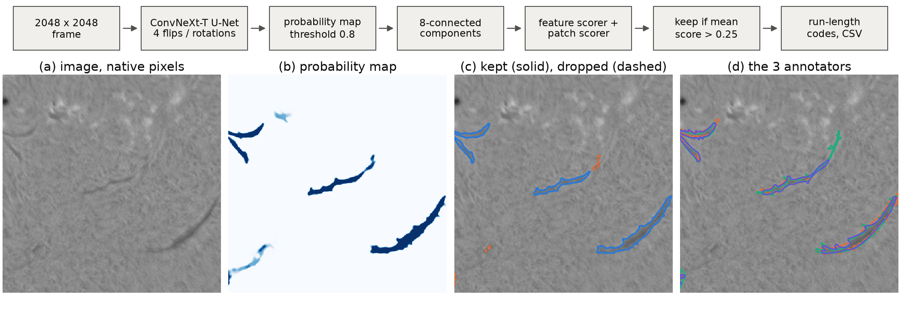

# Solar Filament Segmentation

My solution to the [Solar Filament Segmentation Challenge 2026](https://www.kaggle.com/competitions/filament-segmentation-2026)
(IEEE BigData Cup 2026): instance segmentation of solar filaments in 2048 x 2048 GONG H-alpha
frames, scored with Panoptic Quality (PQ) against every annotator of a frame.

**Report:** [report.pdf](report.pdf)



## How it works

Two annotators of the same frame agree with each other at a PQ of only 0.34. They agree on the
dark cores of the filaments and differ about the faint ones and about where a filament ends. So
instead of imitating one annotator, the network predicts the probability that an annotator marks
a pixel, and the decoder keeps only the pieces of that map that are worth keeping under the metric.

1. A U-Net with a ConvNeXt-T encoder reads the whole 2048 x 2048 frame at native resolution
   (four flipped copies averaged). It was trained on 1024 px crops with the mean of the
   annotators' masks as the target.
2. The map is thresholded at 0.8 and every 8-connected component of at least 30 pixels becomes a
   candidate. Components never overlap, which the leaderboard requires.
3. Two scorers estimate the IoU each candidate will reach against the annotators: gradient-boosted
   trees on twenty numbers per candidate, and three ResNet-18 networks that look at a patch of it.
4. A candidate is kept when the mean of the two estimates is above 0.25. Adding a candidate raises
   pooled PQ exactly when its expected matched IoU is above half the PQ, which is where this
   threshold comes from.

## Results

Out-of-fold on the 707 training frames (each frame scored by models that never saw it), pooled
over all 1,154 annotator records with the competition metric:

| | PQ |
|---|---|
| a second annotator of the same frame | 0.340 |
| connected components only | 0.402 |
| with the feature scorer | 0.455 |
| with the mean of both scorers (submitted) | **0.459** |
| 90% bootstrap interval over frames | 0.451 to 0.467 |
| with perfect keep decisions | 0.519 |

The matched filaments have a mean IoU of 0.68 and a mean Dice of 0.81. Of the annotated filaments,
2.3% are split over several predicted masks, and 2.8% of the predicted masks cover more than one
filament. A test frame takes 0.35 s on one GPU. The report has the distributions, examples of
successes and failures, and ten ideas that did not help.

## Reproduce the submission

The weights are in `weights/` (about 430 MB, no file above 64 MB), so nothing has to be trained.

```bash
pip install torch==2.11.0 torchvision==0.26.0 --index-url https://download.pytorch.org/whl/cu128
pip install -r requirements.txt
```

Put the competition data in `data/` so that the folders look like this:

```
data/MAGFiLO_1.0_Kaggle_2026/train/train_images/*.jpeg
data/MAGFiLO_1.0_Kaggle_2026/train/MAGFiLO_1.0_Annotations_kaggle2026_train.json
data/MAGFiLO_1.0_Kaggle_2026/test/test_images/*.jpeg
```

Then either run

```bash
python scripts/predict.py
```

which writes `submission/submission.csv` (the file I submitted, byte for byte, md5
`a0e0a4e8f9575d949a13337263e38b4a`), or open
[notebooks/solar_filament_segmentation.ipynb](notebooks/solar_filament_segmentation.ipynb), which
goes through the same steps with figures and writes the same file. Both use only the test images at
inference.

## Train from scratch

```bash
python scripts/build_cache.py      # decodes the training frames once, about 9 GB in work/cache
python scripts/train.py            # five folds and one model on all frames, about 12 GPU hours
python scripts/tune.py --final     # threshold, tau and both scorers, on the out-of-fold maps
python scripts/predict.py
```

`train.py` writes the six networks to `weights/` and the out-of-fold maps to `work/runs/`.
`tune.py` prints the out-of-fold PQ for every threshold and, with `--final`, writes the two
scorers and `weights/postprocess.json`. A training process holds about 35 GB of GPU memory,
because all training frames are kept on the GPU and augmented there. The folds are frozen in
`splits/folds.csv`.

```bash
python -m pytest tests -q
```

## Layout

```
filseg/
  config.py        settings and paths from config.yaml
  data.py          annotations, frames, solar disk, training cache
  folds.py         cross-validation folds without leaks
  augment.py       crops and augmentation on the GPU, copy-paste of real filaments
  model.py         the U-Net and its weights
  losses.py        BCE on the soft target, Dice, centre-line term
  training.py      training loop, validation, out-of-fold maps
  inference.py     the probability map of a whole frame
  candidates.py    connected components and their twenty features
  scorers.py       feature scorer, patch scorer, keep rule
  metrics.py       Panoptic Quality as the host computes it
  pipeline.py      one frame from image to filaments
  submission.py    writing and checking the CSV
scripts/           build_cache.py, train.py, tune.py, predict.py
notebooks/         the whole pipeline with figures
weights/           six networks, two scorers, postprocess.json
splits/folds.csv   the five folds
report/            LaTeX source and figures of report.pdf
submission/        the submitted CSV
tests/
```

## Data and rules

I trained only on the images and annotations of the Kaggle bundle (CC BY-NC 4.0), with encoders
pretrained on ImageNet. I did not use the full MAGFiLO release, which contains annotations of the
test frames, and no other ground truth. At test time the pipeline sees only the supplied frame.
Nothing was tuned on the leaderboard. The data is not part of this repository.

## Acknowledgment

This work utilizes GONG data obtained by the NSO Integrated Synoptic Program, managed by the
National Solar Observatory, which is operated by the Association of Universities for Research in
Astronomy (AURA), Inc. under a cooperative agreement with the National Science Foundation and with
contribution from the National Oceanic and Atmospheric Administration. The GONG network of
instruments is hosted by the Big Bear Solar Observatory, High Altitude Observatory, Learmonth Solar
Observatory, Udaipur Solar Observatory, Instituto de Astrofisica de Canarias, and Cerro Tololo
Interamerican Observatory.

## Citation

```bibtex
@misc{muhammadi2026filaments,
  author = {Muhammad Elias Muhammadi},
  title  = {Segmenting Solar Filaments When the Annotators Disagree: One Network and Two Keep-Scorers},
  year   = {2026},
  howpublished = {\url{https://github.com/Muhammad-Elias-Muhammadi/Solar-Filament-Segmentation}}
}
```

The data: Azim Ahmadzadeh et al., A dataset of manually annotated filaments from H-alpha
observations, Scientific Data 11 (2024), doi:10.1038/s41597-024-03876-y. The challenge: Azim
Ahmadzadeh, Dustin J. Kempton, Qin Li and Alexei A. Pevtsov, Solar Filament Segmentation
Challenge 2026, Kaggle.
